# Физика, среднее общее образование (п. 115.9, 116.9 — ЕГЭ) — PDF стр. 1008–1037

пункт 115 дополнить подпунктом 115.9 следующего содержания:

«115.9. В федеральных и региональных процедурах оценки качества образования используется перечень (кодификатор) распределенных по классам проверяемых требований к результатам освоения основной образовательной программы среднего общего образования и элементов содержания по физике.

Таблица 1.1.

Проверяемые требования к результатам освоения основной образовательной программы 10 (класс)

| Код проверяемого результата | Проверяемые предметные результаты освоения основной образовательной программы среднего общего образования |
| --- | --- |
| 10.1 | Демонстрировать на примерах роль и место физики в формировании современной научной картины мира, в развитии современной техники и технологий, в практической деятельности людей |
| 10.2 | Учитывать границы применения изученных физических моделей: материальная точка, инерциальная система отсчёта, абсолютно твёрдое тело, идеальный газ; модели строения газов, жидкостей и твёрдых тел, точечный электрический заряд — при решении физических задач |
| 10.3 | Распознавать физические явления (процессы) и объяснять их на основе законов механики, молекулярно-кинетической теории строения вещества и электродинамики: равномерное и равноускоренное прямолинейное движение, свободное падение тел, движение по окружности, инерция, взаимодействие тел; диффузия, броуновское движение, строение жидкостей и твёрдых тел, изменение объёма тел при нагревании (охлаждении), тепловое равновесие, испарение, конденсация, плавление, кристаллизация, кипение, влажность воздуха, повышение давления газа при его нагревании в закрытом сосуде, связь между параметрами состояния газа в изопроцессах; электризация тел, взаимодействие зарядов |
| 10.4 | Описывать механическое движение, используя физические величины: координата, путь, перемещение, скорость, ускорение, масса тела, сила, импульс тела, кинетическая энергия, потенциальная энергия, механическая работа, механическая мощность; при описании правильно трактовать физический смысл используемых величин, их обозначения и единицы, находить формулы, связывающие данную физическую величину с другими величинами |
| 10.5 | Описывать изученные тепловые свойства тел и тепловые явления, используя физические величины: давление газа, температура, средняя кинетическая энергия хаотического движения молекул, среднеквадратичная скорость молекул, количество теплоты, внутренняя энергия, работа газа, коэффициент полезного действия теплового двигателя; при описании правильно трактовать физический смысл используемых величин, их обозначения и единицы, находить формулы, связывающие данную физическую величину с другими величинам |
| 10.6 | Описывать изученные электрические свойства вещества и электрические явления (процессы), используя физические величины: электрический заряд, электрическое поле, напряжённость поля, потенциал, разность потенциалов; при описании правильно трактовать физический смысл используемых величин, их |
| | обозначения и единицы; указывать формулы, связывающие данную физическую величину с другими величинами |
| 10.7 | анализировать физические процессы и явления, используя физические законы и принципы: закон всемирного тяготения, I, II и III законы Ньютона, закон сохранения механической энергии, закон сохранения импульса, принцип суперпозиции сил, принцип равноправия инерциальных систем отсчёта; молекулярно-кинетическую теорию строения вещества, газовые законы, связь средней кинетической энергии теплового движения молекул с абсолютной температурой, первый закон термодинамики; закон сохранения электрического заряда, закон Кулона; при этом различать словесную формулировку закона, его математическое выражение и условия (границы, области) применимости |
| 10.8 | Объяснять основные принципы действия машин, приборов и технических устройств; различать условия их безопасного использования в повседневной жизни |
| 10.9 | Выполнять эксперименты по исследованию физических явлений и процессов с использованием прямых и косвенных измерений; при этом формулировать проблему/задачу и гипотезу учебного эксперимента, собирать установку из предложенного оборудования, проводить опыт и формулировать выводы |
| 10.10 | Осуществлять прямые и косвенные измерения физических величин; при этом выбирать оптимальный способ измерения и использовать известные методы оценки погрешностей измерений |
| 10.11 | Исследовать зависимости между физическими величинами с использованием прямых измерений; при этом конструировать установку, фиксировать результаты полученной зависимости физических величин в виде таблиц и графиков, делать выводы по результатам исследования |
| 10.12 | Соблюдать правила безопасного труда при проведении исследований в рамках учебного эксперимента, учебно-исследовательской и проектной деятельности с использованием измерительных устройств и лабораторного оборудования |
| 10.13 | Решать расчётные задачи с явно заданной физической моделью, используя физические законы и принципы; на основе анализа условия задачи выбирать физическую модель, выделять физические величины и формулы, необходимые для её решения, проводить расчёты и оценивать реальность полученного значения физической величины |
| 10.14 | Решать качественные задачи: выстраивать логически непротиворечивую цепочку рассуждений с опорой на изученные законы, закономерности и физические явления |
| 10.15 | Использовать при решении учебных задач современные информационные технологии для поиска, структурирования, интерпретации и представления учебной и научно-популярной |
| | информации, полученной из различных источников; критически анализировать получаемую информацию |
| 10.16 | Приводить примеры вклада российских и зарубежных учёных-физиков в развитие науки, объяснение процессов окружающего мира, в развитие техники и технологий |
| 10.17 | Использовать теоретические знания по физике в повседневной жизни для обеспечения безопасности при обращении с приборами и техническими устройствами, для сохранения здоровья и соблюдения норм экологического поведения в окружающей среде |
| 10.18 | Работать в группе с выполнением различных социальных ролей, планировать работу группы, рационально распределять обязанности и планировать деятельность в нестандартных ситуациях, адекватно оценивать вклад каждого из участников группы в решение рассматриваемой проблемы |

Проверяемые элементы содержания (10 класс)

| Код раздела | Код проверяемого элемента | Проверяемые элементы содержания |
| --- | --- | --- |
| 1 | ФИЗИКА И МЕТОДЫ НАУЧНОГО ПОЗНАНИЯ |  |
|  | 1.1 | Физика – наука о природе. Научные методы познания окружающего мира. Роль эксперимента и теории в процессе познания природы. Эксперимент в физике |
|  | 1.2 | Моделирование физических явлений и процессов. Научные гипотезы. Физические законы и теории. Границы применимости физических законов. Принцип соответствия |
| 2 | МЕХАНИКА |  |
| 2.1 | КИНЕМАТИКА |  |
|  | 2.1.1 | Механическое движение. Относительность механического движения. Система отсчёта. Траектория |
|  | 2.1.2 | Перемещение, скорость (средняя скорость, мгновенная скорость) и ускорение материальной точки, их проекции на оси системы координат. Сложение перемещений и сложение скоростей |
|  | 2.1.3 | Равномерное и равноускоренное прямолинейное движение. Графики зависимости координат, скорости, ускорения, пути и перемещения материальной точки от времени |
|  | 2.1.4 | Свободное падение. Ускорение свободного падения |
|  | 2.1.5 | Криволинейное движение. Равномерное движение материальной точки по окружности. Угловая скорость, линейная скорость. Период и частота. Центростремительное ускорение |
|  | 2.1.6 | Технические устройства: спидометр, движение снарядов, цепные и ременные передачи |
|  | 2.1.7 | Практические работы. Измерение мгновенной скорости. Исследование соотношения между путями, пройденными телом за последовательные равные промежутки времени при равноускоренном движении с начальной скоростью, равной нулю |
| 2.2 | ДИНАМИКА |  |
|  | 2.2.1 | Принцип относительности Галилея. Первый закон Ньютона. Инерциальные системы отсчёта |
|  | 2.2.2 | Масса тела. Сила. Принцип суперпозиции сил |
|  | 2.2.3 | Второй закон Ньютона для материальной точки в ИСО. Третий закон Ньютона для материальных точек |
|  | 2.2.4 | Закон всемирного тяготения. Сила тяжести. Первая космическая скорость. Вес тела |
|  | 2.2.5 | Сила упругости. Закон Гука |
|  | 2.2.6 | Сила трения. Сухое трение. Сила трения скольжения и сила трения покоя. Коэффициент трения. Сила сопротивления при движении тела в жидкости или газе |
|  | 2.2.7 | Поступательное и вращательное движение абсолютно твёрдого тела |
|  | 2.2.8 | Момент силы относительно оси вращения. Плечо силы. Условия равновесия твёрдого тела в ИСО |
|  | 2.2.9 | Технические устройства: подшипники, движение искусственных спутников |
|  | 2.2.10 | Практические работы. Изучение движения бруска по наклонной плоскости под действием нескольких сил. Исследование зависимости сил упругости, возникающих в деформируемой пружине и резиновом образце, от величины их деформации. Исследование условий равновесия твёрдого тела, имеющего ось вращения |
| 2.3 | ЗАКОНЫ СОХРАНЕНИЯ В МЕХАНИКЕ |  |
|  | 2.3.1 | Импульс материальной точки, системы материальных точек. Импульс силы и изменение импульса тела |
|  | 2.3.2 | Закон сохранения импульса в ИСО. Реактивное движение |
|  | 2.3.3 | Работа силы |
|  | 2.3.4 | Мощность силы |
|  | 2.3.5 | Кинетическая энергия материальной точки. Теорема о кинетической энергии |
|  | 2.3.6 | Потенциальная энергия. Потенциальная энергия упруго деформированной пружины. Потенциальная энергия тела вблизи поверхности Земли |
|  | 2.3.7 | Связь работы непотенциальных сил с изменением механической энергии системы тел. Закон сохранения механической энергии |
|  | 2.3.8 | Упругие и неупругие столкновения |
|  | 2.3.9 | Технические устройства: движение ракет, водомёт, копер, пружинный пистолет |
|  | 2.3.10 | Практические работы. Изучение связи скоростей тел при неупругом ударе. Исследование связи работы силы с изменением механической энергии тела |
| 3 | МОЛЕКУЛЯРНАЯ ФИЗИКА И ТЕРМОДИНАМИКА |  |
| 3.1 | ОСНОВЫ МКТ |  |
|  | 3.1.1 | Основные положения молекулярно-кинетической теории. Броуновское движение. Диффузия. Характер движения и взаимодействия частиц вещества |
|  | 3.1.2 | Модели строения газов, жидкостей и твёрдых тел и объяснение свойств вещества на основе этих моделей |
|  | 3.1.3 | Масса молекул. Количество вещества. Постоянная Авогадро |
|  | 3.1.4 | Тепловое равновесие. Температура и её измерение. Шкала температур Цельсия |
|  | 3.1.5 | Модель идеального газа. Основное уравнение молекулярно-кинетической теории идеального газа |
|  | 3.1.6 | Абсолютная температура как мера средней кинетической энергии теплового движения частиц газа |
|  | 3.1.7 | Уравнение Клапейрона – Менделеева. Закон Дальтона |
|  | 3.1.8 | Газовые законы. Изопроцессы в идеальном газе с постоянным количеством вещества: изотерма, изохора, изобара |
|  | 3.1.9 | Технические устройства: термометр, барометр |
|  | 3.1.10 | Практические работы. Измерение массы воздуха в классной комнате. Исследование зависимости между параметрами состояния разреженного газа |
| 3.2 | ОСНОВЫ ТЕРМОДИНАМИКИ |  |
|  | 3.2.1 | Термодинамическая система. Внутренняя энергия термодинамической системы и способы её изменения |
|  | 3.2.2 | Количество теплоты и работа. Внутренняя энергия одноатомного идеального газа |
|  | 3.2.3 | Виды теплопередачи: теплопроводность, конвекция, излучение. Теплоёмкость тела. Удельная теплоёмкость вещества. Расчёт количества теплоты при теплопередаче |
|  | 3.2.4 | Первый закон термодинамики. Применение первого закона термодинамики к изопроцессам |
|  | 3.2.5 | Тепловые машины. Принципы действия тепловых машин. Преобразования энергии в тепловых машинах. КПД тепловой машины. Цикл Карно и его КПД |
|  | 3.2.6 | Второй закон термодинамики. Необратимость процессов в природе. Тепловые двигатели. Экологические проблемы теплоэнергетики |
|  | 3.2.7 | Технические устройства: двигатель внутреннего сгорания, бытовой холодильник, кондиционер |
|  | 3.2.8 | Практические работы. Измерение удельной теплоёмкости |
| 3.3 | АГРЕГАТНЫЕ СОСТОЯНИЯ ВЕЩЕСВА. ФАЗОВЫЕ ПЕРЕХОДЫ |  |
|  | 3.3.1 | Парообразование и конденсация. Испарение и кипение. Удельная теплота парообразования. Зависимость температуры кипения от давления |
|  | 3.3.2 | Абсолютная и относительная влажность воздуха. Насыщенный пар |
|  | 3.3.3 | Твёрдое тело. Кристаллические и аморфные тела. Анизотропия свойств кристаллов. Жидкие кристаллы. Современные материалы |
|  | 3.3.4 | Плавление и кристаллизация. Удельная теплота плавления |
|  | 3.3.5 | Уравнение теплового баланса |
|  | 3.3.6 | Технические устройства: гигрометр и психрометр, калориметр, технологии получения современных материалов, в том числе наноматериалов, и нанотехнологии |
|  | 3.3.7 | Практические работы. Измерение влажности воздуха |
| 4 | ЭЛЕКТРОДИНАМИКА |  |
| 4.1 | ЭЛЕКТРОСТАТИКА |  |
|  | 4.1.1 | Электризация тел. Электрический заряд. Два вида электрических зарядов |
|  | 4.1.2 | Проводники, диэлектрики и полупроводники |
|  | 4.1.3 | Закон сохранения электрического заряда |
|  | 4.1.4 | Взаимодействие зарядов. Закон Кулона |
|  | 4.1.5 | Электрическое поле. Напряжённость электрического поля. Принцип суперпозиции. Линии напряжённости электрического поля |
|  | 4.1.6 | Работа сил электростатического поля. Разность потенциалов |
|  | 4.1.7 | Проводники и диэлектрики в постоянном электрическом поле. Диэлектрическая проницаемость |
|  | 4.1.8 | Электроёмкость. Конденсатор. Электроёмкость плоского конденсатора. Энергия заряженного конденсатора |
|  | 4.1.9 | Технические устройства: электроскоп, электрометр, электростатическая защита, заземление электроприборов, конденсатор, ксерокс, струйный принтер |
|  | 4.1.10 | Практические работы. Измерение электроёмкости конденсатора |
| 4.2 | ПОСТОЯННЫЙ ЭЛЕКТРИЧЕСКИЙ ТОК. ТОКИ В РАЗЛИЧНЫХ СРЕДАХ |  |
|  | 4.2.1 | Условия существования постоянного электрического тока. Источники тока. Сила тока. Постоянный ток |
|  | 4.2.2 | Напряжение. Закон Ома для участка цепи |
|  | 4.2.3 | Электрическое сопротивление. Удельное сопротивление вещества |
|  | 4.2.4 | Последовательное, параллельное, смешанное соединение проводников |
|  | 4.2.5 | Работа электрического тока. Закон Джоуля – Ленца |
|  | 4.2.6 | Мощность электрического тока |
|  | 4.2.7 | ЭДС и внутреннее сопротивление источника тока. Закон Ома для полной (замкнутой) электрической цепи |
|  | 4.2.8 | Электронная проводимость твёрдых металлов. Зависимость сопротивления металлов от температуры. Сверхпроводимость |
|  | 4.2.9 | Электрический ток в вакууме. Свойства электронных пучков |
|  | 4.2.10 | Полупроводники. Собственная и примесная проводимость полупроводников. Свойства р-п перехода. Полупроводниковые приборы |
|  | 4.2.11 | Электрический ток в электролитах. Электролитическая диссоциация. Электролиз |
|  | 4.2.12 | Электрический ток в газах. Самостоятельный и несамостоятельный разряд. Различные типы самостоятельного разряда. Молния. Плазма |
|  | 4.2.13 | Технические устройства: амперметр, вольтметр, реостат, источники тока, электронагревательные приборы, электроосветительные приборы, термометр сопротивления, вакуумный диод, термисторы и фоторезисторы, полупроводниковый диод, гальваника |
|  | 4.2.14 | Практические работы. Изучение смешанного соединения резисторов. Измерение ЭДС источника тока и его внутреннего сопротивления. Наблюдение электролиза |

Проверяемые требования к результатам освоения основной образовательной программы (11 класс)

| Код проверяемого результата | Проверяемые предметные результаты освоения основной образовательной программы среднего общего образования |
| --- | --- |
| 11.1 | Демонстрировать на примерах роль и место физики в формировании современной научной картины мира, в развитии современной техники и технологий, в практической деятельности людей, целостность и единство физической картины мира |
| 11.2 | Учитывать границы применения изученных физических моделей: точечный электрический заряд, ядерная модель атома, нуклонная модель атомного ядра при решении физических задач |
| 11.3 | Распознавать физические явления (процессы) и объяснять их на основе законов электродинамики и квантовой физики: электрическая проводимость, тепловое, световое, химическое, магнитное действия тока, взаимодействие магнитов, электромагнитная индукция, действие магнитного поля на проводник с током и движущийся заряд, электромагнитные колебания и волны, прямолинейное распространение света, отражение, преломление, интерференция, дифракция и поляризация света, дисперсия света, фотоэлектрический эффект (фотоэффект), световое давление, возникновение линейчатого спектра атома водорода, естественная и искусственная радиоактивность |
| 11.4 | Описывать изученные свойства вещества (электрические, магнитные, оптические, электрическую проводимость различных сред) и электромагнитные явления (процессы), используя физические величины: электрический заряд, сила тока, электрическое напряжение, электрическое сопротивление, разность потенциалов, ЭДС, работа тока, индукция магнитного поля, сила Ампера, сила Лоренца, индуктивность катушки, энергия электрического и магнитного полей, период и частота колебаний в колебательном контуре, заряд и сила тока в процессе гармонических электромагнитных колебаний, фокусное расстояние и оптическая сила линзы; при описании правильно трактовать физический смысл используемых величин, их обозначения и единицы; указывать формулы, связывающие данную физическую величину с другими величинами |
| 11.5 | Описывать изученные квантовые явления и процессы, используя физические величины: скорость электромагнитных волн, длина волны и частота света, энергия и импульс фотона, период полураспада, энергия связи атомных ядер; при описании правильно трактовать физический смысл используемых величин, их обозначения и единицы; указывать формулы, связывающие данную физическую величину с другими величинами, вычислять значение физической величины |
| 11.6 | Анализировать физические процессы и явления, используя физические законы и принципы: закон Ома, законы последовательного и параллельного соединения проводников, закон Джоуля – Ленца, закон электромагнитной индукции, закон прямолинейного распространения света, законы отражения света, законы преломления света, уравнение Эйнштейна для фотоэффекта, закон сохранения энергии, закон сохранения импульса, закон сохранения электрического заряда, закон сохранения массового числа, постулаты Бора, закон радиоактивного распада; при этом различать словесную формулировку закона, его математическое выражение и условия (границы, области) применимости |
| 11.7 | Определять направление вектора индукции магнитного поля проводника с током, силы Ампера и силы Лоренца |
| 11.8 | Строить и описывать изображение, создаваемое плоским зеркалом, тонкой линзой |
| 11.9 | Выполнять эксперименты по исследованию физических явлений и процессов с использованием прямых и косвенных измерений; при этом формулировать проблему/задачу и гипотезу учебного эксперимента, собирать установку из предложенного оборудования, проводить опыт и формулировать выводы |
| 11.10 | Осуществлять прямые и косвенные измерения физических величин; при этом выбирать оптимальный способ измерения и использовать известные методы оценки погрешностей измерений |
| 11.11 | Исследовать зависимости физических величин с использованием прямых измерений; при этом конструировать установку, фиксировать результаты полученной зависимости физических величин в виде таблиц и графиков, делать выводы по результатам исследования |
| 11.12 | Соблюдать правила безопасного труда при проведении исследований в рамках учебного эксперимента, учебно-исследовательской и проектной деятельности с использованием измерительных устройств и лабораторного оборудования |
| 11.13 | Решать расчётные задачи с явно заданной физической моделью, используя физические законы и принципы; на основе анализа условия задачи выбирать физическую модель, выделять физические величины и формулы, необходимые для её решения, проводить расчёты и оценивать реальность полученного значения физической величины |
| 11.14 | Решать качественные задачи: выстраивать логически непротиворечивую цепочку рассуждений с опорой на изученные законы, закономерности и физические явления |
| 11.15 | Использовать при решении учебных задач современные информационные технологии для поиска, структурирования, интерпретации и представления учебной и научно-популярной информации, полученной из различных источников; критически анализировать получаемую информацию |
| 11.16 | объяснять принципы действия машин, приборов и технических устройств; различать условия их безопасного использования в повседневной жизни |
| 11.17 | Приводить примеры вклада российских и зарубежных учёных-физиков в развитие науки, в объяснение процессов окружающего мира, в развитие техники и технологий |
| 11.18 | Использовать теоретические знания по физике в повседневной жизни для обеспечения безопасности при обращении с приборами и техническими устройствами, для сохранения здоровья и соблюдения норм экологического поведения в окружающей среде |
| 11.19 | Работать в группе с выполнением различных социальных ролей, планировать работу группы, рационально распределять обязанности и планировать деятельность в нестандартных ситуациях, адекватно оценивать вклад каждого из участников группы в решение рассматриваемой проблемы |

Проверяемые элементы содержания (11 класс)

| Код раздела | Код проверяемого элемента | Проверяемые элементы содержания |
| --- | --- | --- |
| 4 | ЭЛЕКТРОДИНАМИКА |  |
| 4.3 | МАГНИТНОЕ ПОЛЕ. ЭЛЕКТРОМАГНИТНАЯ ИНДУКЦИЯ |  |
|  | 4.3.1 | Постоянные магниты. Взаимодействие постоянных магнитов |
|  | 4.3.2 | Магнитное поле. Вектор магнитной индукции. Принцип суперпозиции. Линии магнитной индукции. Картина линий магнитной индукции поля постоянных магнитов |
|  | 4.3.3 | Магнитное поле проводника с током. Картина линий поля длинного прямого проводника и замкнутого кольцевого проводника, катушки с током. Опыт Эрстеда. Взаимодействие проводников с током |
|  | 4.3.4 | Сила Ампера, её модуль и направление |
|  | 4.3.5 | Сила Лоренца, её модуль и направление. Движение заряженной частицы в однородном магнитном поле. Работа силы Лоренца |
|  | 4.3.6 | Явление электромагнитной индукции |
|  | 4.3.7 | Поток вектора магнитной индукции |
|  | 4.3.8 | ЭДС индукции. Закон электромагнитной индукции Фарадея |
|  | 4.3.9 | Вихревое электрическое поле. ЭДС индукции в проводнике, движущемся поступательно в однородном магнитном поле |
|  | 4.3.10 | Правило Ленца |
|  | 4.3.11 | Индуктивность. Явление самоиндукции. ЭДС самоиндукции |
|  | 4.3.12 | Энергия магнитного поля катушки с током |
|  | 4.3.13 | Технические устройства: постоянные магниты, электромагниты, электродвигатель, ускорители элементарных частиц, индукционная печь |
|  | 4.3.14 | Практические работы. Изучение магнитного поля катушки с током. Исследование действия постоянного магнита на рамку с током. Исследование явления электромагнитной индукции |
| 5 | КОЛЕБАНИЯ И ВОЛНЫ |  |
| 5.1 | МЕХАНИЧЕСКИЕ И ЭЛЕКТРОМАГНИТНЫЕ КОЛЕБАНИЯ |  |
|  | 5.1.1 | Колебательная система. Свободные колебания. Гармонические колебания. Период, частота, амплитуда и фаза колебаний |
|  | 5.1.2 | Пружинный маятник. Математический маятник |
|  | 5.1.3 | Уравнение гармонических колебаний. Кинематическое и динамическое описание колебательного движения |
|  | 5.1.4 | Превращение энергии при гармонических колебаниях. Связь амплитуды колебаний исходной величины с амплитудами колебаний её скорости и ускорения |
|  | 5.1.5 | Вынужденные колебания. Резонанс. Резонансная кривая. Автоколебания |
|  | 5.1.6 | Свободные электромагнитные колебания в идеальном колебательном контуре. Аналогия между механическими и электромагнитными колебаниями. Формула Томсона |
|  | 5.1.7 | Закон сохранения энергии в идеальном колебательном контуре |
|  | 5.1.8 | Вынужденные электромагнитные колебания. Резонанс |
|  | 5.1.9 | Переменный ток. Синусоидальный переменный ток. Мощность переменного тока. Амплитудное и действующее значение силы тока и напряжения |
|  | 5.1.10 | Трансформатор. Производство, передача и потребление электрической энергии |
|  | 5.1.11 | Технические устройства: сейсмограф, электрический звонок, линии электропередач |
|  | 5.1.12 | Практические работы. Исследование зависимости периода малых колебаний груза на нити от длины нити и массы груза. Исследование переменного тока в цепи из последовательно соединённых конденсатора, катушки и резистора |
| 5.2 | МЕХАНИЧЕСКИЕ И ЭЛЕКТРОМАГНИТНЫЕ ВОЛНЫ |  |
|  | 5.2.1 | Механические волны, условия распространения. Период. Скорость распространения и длина волны. Поперечные и продольные волны |
|  | 5.2.2 | Интерференция и дифракция механических волн |
|  | 5.2.3 | Звук. Скорость звука. Громкость звука. Высота тона. Тембр звука |
|  | 5.2.4 | Электромагнитные волны. Условия излучения электромагнитных волн. Взаимная ориентация векторов Е, В и ю в электромагнитной волне в вакууме |
|  | 5.2.5 | Свойства электромагнитных волн: отражение, преломление, поляризация, дифракция, интерференция. Скорость электромагнитных волн |
|  | 5.2.6 | Шкала электромагнитных волн. Применение электромагнитных волн в технике и быту |
|  | 5.2.7 | Принципы радиосвязи и телевидения. Радиолокация. Электромагнитное загрязнение окружающей среды |
|  | 5.2.8 | Технические устройства: музыкальные инструменты, ультразвуковая диагностика в технике и медицине, радар, радиоприёмник, телевизор, антенна, телефон, СВЧ-печь |
| 5.3 | ОПТИКА |  |
|  | 5.3.1 | Прямолинейное распространение света в однородной среде. Луч света |
|  | 5.3.2 | Отражение света. Законы отражения света. Построение изображений в плоском зеркале |
|  | 5.3.3 | Преломление света. Законы преломления света. Абсолютный показатель преломления |
|  | 5.3.4 | Полное внутреннее отражение. Предельный угол полного внутреннего отражения |
|  | 5.3.5 | Дисперсия света. Сложный состав белого света. Цвет |
|  | 5.3.6 | Собирающие и рассеивающие линзы. Тонкая линза. Фокусное расстояние и оптическая сила тонкой линзы. Построение изображений в собирающих и рассеивающих линзах. Формула тонкой линзы. Увеличение, даваемое линзой |
|  | 5.3.7 | Пределы применимости геометрической оптики |
|  | 5.3.8 | Интерференция света. Когерентные источники. Условия наблюдения максимумов и минимумов в интерференционной картине от двух синфазных когерентных источников |
|  | 5.3.9 | Дифракция света. Дифракционная решётка. Условие наблюдения главных максимумов при падении монохроматического света на дифракционную решётку |
|  | 5.3.10 | Поляризация света |
|  | 5.3.11 | Технические устройства: очки, лупа, фотоаппарат, проекционный аппарат, микроскоп, телескоп, волоконная оптика, дифракционная решётка, поляроид |
|  | 5.3.12 | Практические работы. Измерение показателя преломления. Исследование свойств изображений в линзах. Наблюдение дисперсии света |
| 6 | ЭЛЕМЕНТЫ СТО |  |
|  | 6.1 | Постулаты теории относительности: инвариантность модуля скорости света в вакууме, принцип относительности Эйнштейна |
|  | 6.2 | Относительность одновременности. Замедление времени и сокращение длины |
|  | 6.3 | Энергия и импульс свободной частицы |
|  | 6.4 | Связь массы с энергией и импульсом свободной частицы. Энергия покоя свободной частицы |
| 7 | КВАНТОВАЯ ФИЗИКА |  |
| 7.1 | ЭЛЕМЕНТЫ КВАНТОВОЙ ОПТИКИ |  |
|  | 7.1.1 | Фотоны. Формула Планка связи энергии фотона с его частотой. Энергия и импульс фотона |
|  | 7.1.2 | Открытие и исследование фотоэффекта. Опыты А.Г. Столетова. Законы фотоэффекта |
|  | 7.1.3 | Уравнение Эйнштейна для фотоэффекта. «Красная граница» фотоэффекта |
|  | 7.1.4 | Давление света. Опыты П.Н. Лебедева |
|  | 7.1.5 | Химическое действие света |
|  | 7.1.6 | Технические устройства: фотоэлемент, фотодатчик, солнечная батарея, светодиод |
| 7.2 | СТРОЕНИЕ АТОМА |  |
|  | 7.2.1 | Модель атома Томсона. Опыты Резерфорда по исследованию строения атома. Планетарная модель атома |
|  | 7.2.2 | Постулаты Бора. Излучение и поглощение фотонов при переходе атома с одного уровня энергии на другой. Виды спектров. Спектр уровней энергии атома водорода |
|  | 7.2.3 | Волновые свойства частиц. Волны де Бройля. Корпускулярно-волновой дуализм. Дифракция электронов на кристаллах |
|  | 7.2.4 | Спонтанное и вынужденное излучение. Устройство и принцип работы лазера |
|  | 7.2.5 | Технические устройства: спектральный анализ (спектроскоп), лазер, квантовый компьютер |
|  | 7.2.6 | Практические работы. Наблюдение линейчатого спектра |
| 7.3 | АТОМНОЕ ЯДРО |  |
|  | 7.3.1 | Методы наблюдения и регистрации элементарных частиц |
|  | 7.3.2 | Открытие радиоактивности. Опыты Резерфорда по определению состава радиоактивного излучения. Свойства альфа-, бета-, гамма-излучения. Влияние радиоактивности на живые организмы |
|  | 7.3.3 | Открытие протона и нейтрона. Нуклонная модель ядра Гейзенберга – Иваненко. Заряд ядра. Массовое число ядра. Изотопы |
|  | 7.3.4 | Альфа-распад. Электронный и позитронный бета-распад. Гамма-излучение. Закон радиоактивного распада |
|  | 7.3.5 | Энергия связи нуклонов в ядре. Ядерные силы. Дефект массы ядра |
|  | 7.3.6 | Ядерные реакции. Деление и синтез ядер |
|  | 7.3.7 | Ядерный реактор. Термоядерный синтез. Проблемы и перспективы ядерной энергетики. Экологические аспекты ядерной энергетики |
|  | 7.3.8 | Элементарные частицы. Открытие позитрона. Фундаментальные взаимодействия |
|  | 7.3.9 | Технические устройства: дозиметр, камера Вильсона, ядерный реактор, атомная бомба |
|  | 7.3.10 | Практические работы. Исследование треков частиц (по готовым фотографиям) |
| 8 | ЭЛЕМЕНТЫ АСТРОФИЗИКИ |  |
|  | 8.1 | Вид звёздного неба. Созвездия, яркие звёзды, планеты, их видимое движение |
|  | 8.2 | Солнечная система. Планеты земной группы. Планеты- гиганты и их спутники, карликовые планеты. Малые тела Солнечной системы |
|  | 8.3 | Солнце, фотосфера и атмосфера. Солнечная активность |
|  | 8.4 | Источник энергии Солнца и звёзд. Внутреннее строение Солнца. Условие равновесия в Солнце. Температура в центре Солнца. Перенос энергии из центра Солнца. Солнечные нейтрино |
|  | 8.5 | Звёзды, их основные характеристики: масса, светимость, радиус, температура, их взаимосвязь. Диаграмма «спектральный класс – светимость». Звёзды главной последовательности. Зависимость «масса – светимость» для звёзд главной последовательности |
|  | 8.6 | Внутреннее строение звёзд. Современные представления о происхождении и эволюции Солнца и звёзд. Этапы жизни звёзд |
|  | 8.7 | Млечный Путь – наша Галактика. Спиральная структура Галактики, распределение звёзд, газа и пыли. Положение и движение Солнца в Галактике. Плоская и сферическая подсистемы Галактики |
|  | 8.8 | Типы галактик. Радиогалактики и квазары. Чёрные дыры в ядрах галактик |
|  | 8.9 | Вселенная. Расширение Вселенной. Закон Хаббла. Разбегание галактик. Возраст и радиус Вселенной, теория Большого взрыва. Модель «горячей Вселенной». Реликтовое излучение |
|  | 8.10 | Масштабная структура Вселенной. Метагалактика |

»;

пункт 116 дополнить подпунктом 116.9 следующего содержания:

«116.9. Для проведения единого государственного экзамена по физике (далее – ЕГЭ по физике) используется перечень (кодификатор) проверяемых требований к результатам освоения основной образовательной программы среднего общего образования и элементов содержания.

Таблица 1

Проверяемые на ЕГЭ по физике требования к результатам освоения основной образовательной программы среднего общего образования

| Код проверяемого требования | Проверяемые требования к предметным результатам освоения основной образовательной программы среднего общего образования |
| --- | --- |
| 1 | Сформированность умений распознавать физические явления (процессы) и объяснять их на основе изученных законов |
| 2 | Владение основополагающими физическими понятиями и величинами, характеризующими физические процессы |
| 3 | Сформированность умений применять законы классической механики, молекулярной физики и термодинамики, электродинамики, квантовой физики для анализа и объяснения явлений микромира, макромира и мегамира, различать условия (границы, области) применимости физических законов, понимать всеобщий характер фундаментальных законов и ограниченность использования частных законов; анализировать физические процессы, используя основные положения, законы и закономерности |
| 4 | Сформированность умения различать условия применимости моделей физических тел и процессов (явлений) |
| 5 | Сформированность умения решать расчётные задачи с явно заданной и неявно заданной физической моделью: на основании анализа условия выбирать физические модели, отвечающие требованиям задачи, применять формулы, законы, закономерности и постулаты физических теорий при использовании математических методов решения задач, проводить расчёты на основании имеющихся данных, анализировать результаты и корректировать методы решения с учётом полученных результатов |
| 6 | Решать качественные задачи, требующие применения знаний из разных разделов школьного курса физики, а также интеграции знаний из других предметов естественнонаучного цикла: выстраивать логическую цепочку рассуждений с опорой на изученные законы, закономерности и физические явления |
| 7 | Владение основными методами научного познания, используемыми в физике: проводить прямые и косвенные измерения физических величин, выбирая оптимальный способ измерения и используя известные методы оценки погрешностей измерений, проводить исследование зависимостей физических величин с |
| | использованием прямых измерений, объяснять полученные результаты, используя физические теории, законы и понятия, и делать выводы; соблюдать правила безопасного труда при проведении исследований в рамках учебного эксперимента и учебно-исследовательской деятельности с использованием цифровых измерительных устройств и лабораторного оборудования |
| 8 | Сформированность умений анализировать и оценивать последствия бытовой и производственной деятельности человека, связанной с физическими процессами, с позиций экологической безопасности; представлений о рациональном природопользовании, а также разумном использовании достижений науки и технологий для дальнейшего развития человеческого общества |
| 9 | Овладение различными способами работы с информацией физического содержания с использованием современных информационных технологий; развитие умений критического анализа и оценки достоверности получаемой информации |
| 10 | Сформированность умений применять основополагающие астрономические понятия, теории и законы для анализа и объяснения физических процессов, происходящих на звёздах, в звёздных системах, в межгалактической среде; движения небесных тел, эволюции звёзд и Вселенной |

Перечень элементов содержания, проверяемых на ЕГЭ по физике

| Код раздела/темы | Код элемента | Проверяемый элемент содержания |
| --- | --- | --- |
| 1 |  | МЕХАНИКА |
| 1.1 |  | КИНЕМАТИКА |
|  | 1.1.1 | Механическое движение. Относительность механического движения. Система отсчёта |
|  | 1.1.2 | 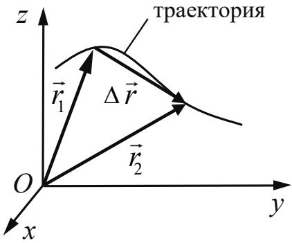Материальная точка. Её радиус-вектор: $\vec{r}(t) = (x(t), y(t), z(t))$, траектория, |
|  |  | перемещение: $\Delta\vec{r} = \vec{r}(t_2) - \vec{r}(t_1) = \vec{r}_2 - \vec{r}_1 = (\Delta x, \Delta y, \Delta z),$ путь. Сложение перемещений: $\Delta\vec{r}_1 = \Delta\vec{r}_2 + \Delta\vec{r}_0$ |
|  | 1.1.3 | Скорость материальной точки: $\vec{\upsilon} = \frac{\Delta\vec{r}}{\Delta t} \bigg\vert_{\Delta t \to 0} = \vec{r}_t' = (\upsilon_x, \upsilon_y, \upsilon_z),$ $\upsilon_x = \frac{\Delta x}{\Delta t} \bigg\vert_{\Delta t \to 0} = x_t', \text{ аналогично } \upsilon_y = y_t', \upsilon_z = z_t'.$ Сложение скоростей: $\vec{\upsilon}_1 = \vec{\upsilon}_2 + \vec{\upsilon}_0$. Вычисление перемещения и пути материальной точки при прямолинейном движении вдоль оси х по графику зависимости $\upsilon_x(t)$ |
|  | 1.1.4 | Ускорение материальной точки: $\vec{a} = \frac{\Delta\vec{\upsilon}}{\Delta t} \bigg\vert_{\Delta t \to 0} = \vec{\upsilon}_t' = (a_x, a_y, a_z),$ $a_x = \frac{\Delta \upsilon_x}{\Delta t} \bigg\vert_{\Delta t \to 0} = (\upsilon_x)_t', \text{ аналогично } a_y = (\upsilon_y)_t', a_z = (\upsilon_z)_t'.$ |
|  | 1.1.5 | Равномерное прямолинейное движение: $x(t) = x_0 + \upsilon_{0x} t$ $\upsilon_x(t) = \upsilon_{0x} = \text{const}$ |
|  | 1.1.6 | Равноускоренное прямолинейное движение: $x(t) = x_0 + \upsilon_{0x} t + \frac{a_x t^2}{2}$ $\upsilon_x(t) = \upsilon_{0x} + a_x t$ $a_x = \text{const}$ $\upsilon_{2x}^2 - \upsilon_{1x}^2 = 2a_x (x_2 - x_1)$ При движении в одном направлении путь $S = \frac{\upsilon_1 + \upsilon_2}{2} \cdot t$ |
|  | 1.1.7 | Свободное падение. Ускорение свободного падения. Движение тела, брошенного под углом $\alpha$ к горизонту: $\begin{cases} x(t) = x_0 + \upsilon_{0x} t = x_0 + \upsilon_0 \cos \alpha \cdot t \\ y(t) = y_0 + \upsilon_{0y} t + \frac{g_y t^2}{2} = y_0 + \upsilon_0 \sin \alpha \cdot t - \frac{gt^2}{2} \end{cases}$ 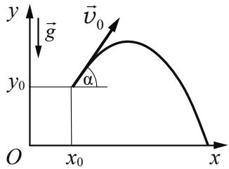 |
|  |  | $\begin{cases} \upsilon_x(t) = \upsilon_{0x} = \upsilon_0 \cos \alpha \\ \upsilon_y(t) = \upsilon_{0y} + g_y t = \upsilon_0 \sin \alpha - gt \\ g_x = 0 \\ g_y = -g = const \end{cases}$ |
|  | 1.1.8 | Криволинейное движение. Движение материальной точки по окружности. Угловая и линейная скорость точки: $\upsilon = \omega R$. При равномерном движении точки по окружности $\omega = \frac{2\pi}{T} = 2\pi\nu$. Центростремительное ускорение точки: $a_{\text{цс}} = \frac{\upsilon^2}{R} = \omega^2 R$. Полное ускорение материальной точки |
|  | 1.1.9 | Твёрдое тело. Поступательное и вращательное движение твёрдого тела |
| 1.2 |  | ДИНАМИКА |
|  | 1.2.1 | Инерциальные системы отсчёта. Первый закон Ньютона. Принцип относительности Галилея |
|  | 1.2.2 | Масса тела. Плотность вещества: $\rho = \frac{m}{V}$ |
|  | 1.2.3 | Сила. Принцип суперпозиции сил: $\vec{F}_{\text{равнодейств}} = \vec{F}_1 + \vec{F}_2 +...$ |
|  | 1.2.4 | Второй закон Ньютона: для материальной точки в ИСО $\vec{F} = m\vec{a}$; $\Delta\vec{p} = \vec{F}\Delta t$ при $\vec{F} = const$ |
|  | 1.2.5 | Третий закон Ньютона для материальных точек: $\vec{F}_{12} = -\vec{F}_{21}$ 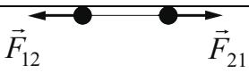 |
|  | 1.2.6 | Закон всемирного тяготения: силы притяжения между точечными массами равны $F = G \frac{m_1 m_2}{R^2}$. Сила тяжести. Центр тяжести тела. Зависимость силы тяжести от высоты h над поверхностью планеты радиусом $R_0$: $mg = \frac{GMm}{(R_0 + h)^2}$ |
|  | 1.2.7 | Сила упругости. Закон Гука: $F_x = -kx$ |
|  | 1.2.8 | Сила трения. Сухое трение. Сила трения скольжения: $F_{\text{тр}} = \mu N$. Сила трения покоя: $F_{\text{тр}} \leq \mu N$. Коэффициент трения |
|  | 1.2.9 | Давление: $p = \frac{F_\perp}{S}$ |
| 1.3 |  | СТАТИКА |
|  | 1.3.1 | Момент силы относительно оси вращения: $\vert M\vert = Fl$, где l – плечо силы $\vec{F}$ 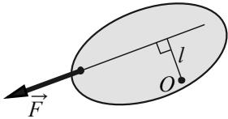 относительно оси, проходящей через точку О перпендикулярно рисунку |
|  | 1.3.2 | Центр масс тела. Центр масс системы материальных точек: $\vec{r}_{\text{ц.м.}} = \frac{m_1 \vec{r}_1 + m_2 \vec{r}_2 +...}{m_1 + m_2 +...}$. В однородном поле тяжести ( $\vec{g} = \text{const}$ ) центр масс тела совпадает с его центром тяжести |
|  | 1.3.3 | Условия равновесия твёрдого тела в ИСО: $\begin{cases} M_1 + M_2 +... = 0 \\ \vec{F}_1 + \vec{F}_2 +... = 0 \end{cases}$ |
|  | 1.3.4 | Закон Паскаля |
|  | 1.3.5 | Давление в жидкости, покоящейся в ИСО: $p = p_0 + \rho gh$ |
|  | 1.3.6 | Закон Архимеда: $\vec{F}_{\text{Арх}} = -\vec{P}_{\text{вытесн}}$, если тело и жидкость покоятся в ИСО, то $F_{\text{Арх}} = pg V_{\text{вытесн}}$ Условие плавания тел |
| 1.4 |  | ЗАКОНЫ СОХРАНЕНИЯ В МЕХАНИКЕ |
|  | 1.4.1 | Импульс материальной точки: $\vec{p} = m\vec{\upsilon}$ |
|  | 1.4.2 | Импульс системы тел: $\vec{p} = \vec{p}_1 + \vec{p}_2 +...$ |
|  | 1.4.3 | Закон изменения и сохранения импульса: в ИСО $\Delta\vec{p} \equiv \Delta(\vec{p}_1 + \vec{p}_2 +...)=\vec{F}_{1_{\text{внешн}}} \Delta t + \vec{F}_{2_{\text{внешн}}} \Delta t +...$; в ИСО $\Delta\vec{p} \equiv \Delta(\vec{p}_1 + \vec{p}_2 +...)=0$, если $\vec{F}_{1_{\text{внешн}}} + \vec{F}_{2_{\text{внешн}}} +... = 0$ Реактивное движение |
|  | 1.4.4 | Работа силы на малом перемещении: $A = \vert \vec{F}\vert \cdot \vert \Delta\vec{r}\vert \cdot \cos \alpha = F_x \cdot \Delta x$ 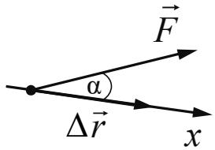 |
|  | 1.4.5 | Мощность силы: если за время $\Delta t$ работа силы изменяется на $\Delta A$, то мощность силы 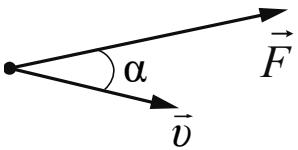 $P = \frac{\Delta A}{\Delta t} \bigg\vert_{\Delta t \to 0} = F \cdot \upsilon \cdot \cos \alpha$ |
|  | 1.4.6 | Кинетическая энергия материальной точки: $E_{\text{кин}} = \frac{m\upsilon^2}{2} = \frac{p^2}{2m}$. Закон изменения кинетической энергии системы материальных точек: в ИСО $\Delta E_{\text{кин}} = A_1 + A_2 +...$ |
|  | 1.4.7 | Потенциальная энергия: для потенциальных сил $A_{12} = E_{1_{\text{потенц}}} - E_{2_{\text{потенц}}} = -\Delta E_{\text{потенц}}$. Потенциальная энергия материальной точки в однородном поле тяжести: $E_{\text{потенц}} = mgh$. |
|  |  | Потенциальная энергия упруго деформированного тела: $E_{\text{потенц}} = \frac{kx^{2}}{2}$ |
|  | 1.4.8 | Закон изменения и сохранения механической энергии: $E_{\text{мех}} = E_{\text{кин}} + E_{\text{потенц}},$ в ИСО $\Delta E_{\text{мех}} = A_{\text{всех непотенц. сил}},$ в ИСО $\Delta E_{\text{мех}} = 0$, если $A_{\text{всех непотенц. сил}} = 0$ |
| 1.5 |  | МЕХАНИЧЕСКИЕ КОЛЕБАНИЯ И ВОЛНЫ |
|  | 1.5.1 | Гармонические колебания материальной точки. Амплитуда и фаза колебаний. Кинематическое описание: $x(t) = A \sin(\omega t + \varphi_{0})$, $\upsilon_{x}(t) = x_{t}^{\prime},$ $a_{x}(t) = (\upsilon_{x})_{t}^{\prime} = -\omega^{2} x(t) \Rightarrow a_{x} + \omega^{2} x = 0$, где $x$ – смещение из положения равновесия. Динамическое описание: $ma_{x} = -kx$, где $k = m\omega^{2}$. Это значит, что $F_{x} = -kx$. Энергетическое описание (закон сохранения механической энергии): $\frac{m\upsilon^{2}}{2} + \frac{kx^{2}}{2} = \frac{m\upsilon_{\max}^{2}}{2} = \frac{kA^{2}}{2} = const$ |
|  |  | Связь амплитуды колебаний смещения материальной точки с амплитудами колебаний её скорости и ускорения: $\upsilon_{\text{max}} = \omega A, a_{\text{max}} = \omega^{2} A$ |
|  | 1.5.2 | Период и частота колебаний: $T = \frac{2\pi}{\omega} = \frac{1}{\nu}$. Период малых свободных колебаний математического маятника: $T = 2\pi \sqrt{\frac{l}{g}}$. Период свободных колебаний пружинного маятника: $T = 2\pi \sqrt{\frac{m}{k}}$ |
|  | 1.5.3 | Вынужденные колебания. Резонанс. Резонансная кривая |
|  | 1.5.4 | Поперечные и продольные волны. Скорость распространения и длина волны: $\lambda = \upsilon T = \frac{\upsilon}{\nu}$. Интерференция и дифракция волн |
|  | 1.5.5 | Звук. Скорость звука |
| 2 |  | МОЛЕКУЛЯРНАЯ ФИЗИКА. ТЕРМОДИНАМИКА |
| 2.1 |  | МОЛЕКУЛЯРНАЯ ФИЗИКА |
|  | 2.1.1 | Модели строения газов, жидкостей и твёрдых тел. Пусть термодинамическая система (тело) состоит из N одинаковых |
|  |  | молекул. Тогда количество вещества $\nu = \frac{N}{N_{\text{А}}} = \frac{m}{\mu}$, где $N_{\text{А}}$ — число Авогадро, m — масса системы (тела), μ — молярная масса вещества |
|  | 2.1.2 | Тепловое движение атомов и молекул вещества |
|  | 2.1.3 | Взаимодействие частиц вещества |
|  | 2.1.4 | Диффузия. Броуновское движение |
|  | 2.1.5 | Модель идеального газа в МКТ |
|  | 2.1.6 | Связь между давлением и средней кинетической энергией поступательного теплового движения молекул идеального газа (основное уравнение МКТ): $p = \frac{1}{3} m_{0} n \overline{\upsilon^{2}} = \frac{2}{3} n \cdot \overline{\left( \frac{m_{0} \upsilon^{2}}{2} \right)} = \frac{2}{3} n \cdot \overline{\varepsilon_{\text{пост}}}$, где $m_{0}$ — масса одной молекулы, $n = \frac{N}{V}$ — концентрация молекул |
|  | 2.1.7 | Абсолютная температура: $T = t^{\circ} + 273 \text{K}$ |
|  | 2.1.8 | Связь температуры газа со средней кинетической энергией поступательного теплового движения его молекул: $\overline{\varepsilon_{\text{пост}}} = \overline{\left( \frac{m_{0} \upsilon^{2}}{2} \right)} = \frac{3}{2} kT$ |
|  | 2.1.9 | Уравнение $p = nkT$ |
|  | 2.1.10 | Модель идеального газа в термодинамике: $\begin{cases} \text{Уравнение Менделеева} - \text{Клапейрона} \\ \text{Выражение для внутренней энергии} \end{cases}$ Уравнение Менделеева — Клапейрона (применимые формы записи): $pV = \frac{m}{\mu} RT = \nu RT = NkT, \ p = \frac{\rho RT}{\mu}.$ Выражение для внутренней энергии одноатомного идеального газа (применимые формы записи): $U = \frac{3}{2} \nu RT = \frac{3}{2} NkT = \frac{3}{2} \frac{m}{\mu} RT = \nu c_{\upsilon} T = \frac{3}{2} pV$ |
|  | 2.1.11 | Закон Дальтона для давления смеси разреженных газов: $p = p_{1} + p_{2} + \ldots$ |
|  | 2.1.12 | Изопроцессы в разреженном газе с постоянным числом молекул N (с постоянным количеством вещества ν): изотерма (T = const): $pV = \text{const}$, изохора (V = const): $\frac{p}{T} = \text{const}$, изобара (p = const): $\frac{V}{T} = \text{const}$ |
|  |  | Графическое представление изопроцессов на pV-, pT- и VT-диаграммах. Объединенный газовый закон: $\frac{pV}{T} = const$ для постоянного количества вещества ν |
|  | 2.1.13 | Насыщенные и ненасыщенные пары. Качественная зависимость плотности и давления насыщенного пара от температуры, их независимость от объёма насыщенного пара |
|  | 2.1.14 | Влажность воздуха. Относительная влажность: $\varphi = \frac{p_{\text{пара}}(T)}{p_{\text{насыщ, пара}}(T)} = \frac{\rho_{\text{пара}}(T)}{\rho_{\text{насыщ, пара}}(T)}$ |
|  | 2.1.15 | Изменение агрегатных состояний вещества: испарение и конденсация, кипение жидкости |
|  | 2.1.16 | Изменение агрегатных состояний вещества: плавление и кристаллизация |
|  | 2.1.17 | Преобразование энергии в фазовых переходах |
| 2.2 |  | ТЕРМОДИНАМИКА |
|  | 2.2.1 | Тепловое равновесие и температура |
|  | 2.2.2 | Внутренняя энергия |
|  | 2.2.3 | Теплопередача как способ изменения внутренней энергии без совершения работы. Конвекция, теплопроводность, излучение |
|  | 2.2.4 | Количество теплоты. Удельная теплоёмкость вещества с: $Q = cm\Delta T$ |
|  | 2.2.5 | Удельная теплота парообразования L: $Q = Lm$. Удельная теплота плавления λ: $Q = \lambda m$. Удельная теплота сгорания топлива q: $Q = qm$ |
|  | 2.2.6 | Элементарная работа в термодинамике: $A = p\Delta V$. Вычисление работы по графику процесса на pV-диаграмме |
|  | 2.2.7 | Первый закон термодинамики: $Q_{12} = \Delta U_{12} + A_{12} = (U_2 - U_1) + A_{12}$. Адиабата: $Q_{12} = 0 \Rightarrow A_{12} = U_1 - U_2 = -\Delta U_{12}$ |
|  | 2.2.8 | Второй закон термодинамики. Необратимые процессы |
|  | 2.2.9 | Принципы действия тепловых машин. КПД: $\eta = \frac{A_{\text{за цикл}}}{Q_{\text{нагр}}} = \frac{Q_{\text{нагр}} - \vert Q_{\text{хол}}\vert}{Q_{\text{нагр}}} = 1 - \frac{\vert Q_{\text{хол}}\vert}{Q_{\text{нагр}}}$ |
|  | 2.2.10 | Максимальное значение КПД. Цикл Карно: $max\eta = \eta_{\text{Карно}} = \frac{T_{\text{нагр}} - T_{\text{хол}}}{T_{\text{нагр}}} = 1 - \frac{T_{\text{хол}}}{T_{\text{нагр}}}$ |
|  | 2.2.11 | Уравнение теплового баланса: $Q_1 + Q_2 + Q_3 + \ldots = 0$ |
| 3 |  | ЭЛЕКТРОДИНАМИКА |
| 3.1 |  | ЭЛЕКТРИЧЕСКОЕ ПОЛЕ |
|  | 3.1.1 | Электризация тел и её проявления. Электрический заряд. Два вида заряда. Элементарный электрический заряд. Закон сохранения электрического заряда |
|  | 3.1.2 | Взаимодействие зарядов. Точечные заряды. Закон Кулона: в однородном веществе с диэлектрической проницаемостью $\varepsilon$ $F = k \frac{\vert q_1\vert \cdot \vert q_2\vert}{\varepsilon r^2} = \frac{1}{4\pi\varepsilon\varepsilon_0} \cdot \frac{\vert q_1\vert \cdot \vert q_2\vert}{r^2}$ |
|  | 3.1.3 | Электрическое поле. Его действие на электрические заряды |
|  | 3.1.4 | Напряжённость электрического поля: $\vec{E} = \frac{\vec{F}}{q_{\text{пробный}}}$. Поле точечного заряда: $E_r = k \frac{q}{r^2}$, однородное поле: $\vec{E} = \text{const}.$ Картины линий напряжённости этих полей |
|  | 3.1.5 | Потенциальность электростатического поля. Разность потенциалов и напряжение: $A_{12} = q(\varphi_1 - \varphi_2) = -q\Delta\varphi = qU$. Потенциальная энергия заряда в электростатическом поле: $W = q\varphi$. $A = -\Delta W$ Потенциал электростатического поля: $\varphi = \frac{W}{q}$. Связь напряжённости поля и разности потенциалов для однородного электростатического поля: $U = Ed$ |
|  | 3.1.6 | Принцип суперпозиции электрических полей: $\vec{E} = \vec{E}_1 + \vec{E}_2 + \ldots, \quad \varphi = \varphi_1 + \varphi_2 + \ldots$ |
|  | 3.1.7 | Проводники в электростатическом поле. Условие равновесия зарядов: внутри проводника $\vec{E} = 0$, внутри и на поверхности проводника $\varphi = \text{const}$ |
|  | 3.1.8 | Диэлектрики в электростатическом поле. Диэлектрическая проницаемость вещества $\varepsilon$ |
|  | 3.1.9 | Конденсатор. Электроёмкость конденсатора: $C = \frac{q}{U}$. Электроёмкость плоского конденсатора: $C = \frac{\varepsilon\varepsilon_0S}{d} = \varepsilon C_0$ |
|  | 3.1.10 | Параллельное соединение конденсаторов: $q = q_1 + q_2 + \ldots, U_1 = U_2 = \ldots, C_{\text{паралл}} = C_1 + C_2 + \ldots$ Последовательное соединение конденсаторов: |
|  |  | $U = U_1 + U_2 + \dots, q_1 = q_2 = \dots, \frac{1}{C_{\text{посл}}} = \frac{1}{C_1} + \frac{1}{C_2} + \dots$ |
|  | 3.1.11 | Энергия заряженного конденсатора: $W_C = \frac{qU}{2} = \frac{CU^2}{2} = \frac{q^2}{2C}$ |
| 3.2 |  | ЗАКОНЫ ПОСТОЯННОГО ТОКА |
|  | 3.2.1 | Сила тока: $I = \frac{\Delta q}{\Delta t} \bigg\vert_{\Delta t \to 0}$. Постоянный ток: $I = \text{const}$ Для постоянного тока $q = It$ |
|  | 3.2.2 | Условия существования электрического тока. Напряжение U и ЭДС E |
|  | 3.2.3 | Закон Ома для участка цепи: $I = \frac{U}{R}$ |
|  | 3.2.4 | Электрическое сопротивление. Зависимость сопротивления однородного проводника от его длины и сечения. Удельное сопротивление вещества. $R = \rho \frac{l}{S}$ |
|  | 3.2.5 | Источники тока. ЭДС источника тока: $\mathcal{E} = \frac{A_{\text{сторонних сил}}}{q}$. Внутреннее сопротивление источника тока |
|  | 3.2.6 | Закон Ома для полной (замкнутой) электрической цепи: $\mathcal{E} = IR + Ir$, откуда 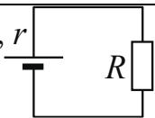 $I = \frac{\mathcal{E}}{R + r}$ |
|  | 3.2.7 | Параллельное соединение проводников: $I = I_1 + I_2 +..., U_1 = U_2 =..., \frac{1}{R_{\text{паралл}}} = \frac{1}{R_1} + \frac{1}{R_2} +...$. Последовательное соединение проводников: $U = U_1 + U_2 +..., I_1 = I_2 =..., R_{\text{посл}} = R_1 + R_2 +...$ |
|  | 3.2.8 | Работа электрического тока: $A = IUt$. Закон Джоуля – Ленца: $Q = I^2Rt$. На резисторе $R: Q = A = I^2Rt = IUt = \frac{U^2}{R}t$ |
|  | 3.2.9 | Мощность электрического тока: $P = \frac{\Delta A}{\Delta t} \bigg\vert_{\Delta t \to 0} = IU$. Тепловая мощность, выделяемая на резисторе: $P = I^2R = \frac{U^2}{R} = IU$. Мощность источника тока: $P_{\mathcal{E}} = \frac{\Delta A_{\text{ст. сил}}}{\Delta t} \bigg\vert_{\Delta t \to 0} = \mathcal{E}I$ |
|  | 3.2.10 | Свободные носители электрических зарядов в проводниках. Механизмы проводимости твёрдых металлов, растворов и |
|  |  | расплавов электролитов, газов. Полупроводники. Полупроводниковый диод |
| 3.3 |  | МАГНИТНОЕ ПОЛЕ |
|  | 3.3.1 | Механическое взаимодействие магнитов. Магнитное поле. Вектор магнитной индукции. Принцип суперпозиции магнитных полей: $\vec{B} = \vec{B}_{1} + \vec{B}_{2} + \ldots$. Линии индукции магнитного поля. Картина линий индукции магнитного поля полосового и подковообразного постоянных магнитов |
|  | 3.3.2 | Опыт Эрстеда. Магнитное поле проводника с током. Картина линий индукции магнитного поля длинного прямого проводника и замкнутого кольцевого проводника, катушки с током |
|  | 3.3.3 | Сила Ампера, её направление и величина: $F_{\text{А}} = IBl \sin \alpha$, где $\alpha$ – угол между направлением проводника и вектором $\vec{B}$ |
|  | 3.3.4 | Сила Лоренца, её направление и величина: $F_{\text{Лор}} = \vert q\vert \upsilon B \sin \alpha$, где $\alpha$ – угол между векторами $\vec{\upsilon}$ и $\vec{B}$. Движение заряженной частицы в однородном магнитном поле |
| 3.4 |  | ЭЛЕКТРОМАГНИТНАЯ ИНДУКЦИЯ |
|  | 3.4.1 | Поток вектора магнитной индукции: $\Phi = B_{n}S = BS \cos \alpha$ 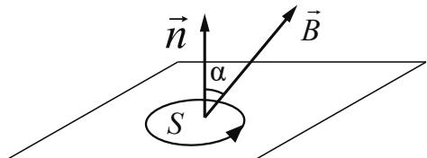 |
|  | 3.4.2 | Явление электромагнитной индукции. ЭДС индукции |
|  | 3.4.3 | Закон электромагнитной индукции Фарадея: $\left. \mathcal{E}_{i} = -\frac{\Delta \Phi}{\Delta t} \right\vert_{\Delta t \to 0} = -\Phi'_{t}$ |
|  | 3.4.4 | ЭДС индукции в прямом проводнике длиной l, движущемся со скоростью $\vec{\upsilon}$ $(\vec{\upsilon} \perp \vec{l})$ в однородном магнитном поле В: $\vert \mathcal{E}_{i}\vert = Bl\upsilon \cos \alpha$, где $\alpha$ – угол между вектором В и нормалью $\vec{n}$ к плоскости, в которой лежат векторы $\vec{l}$ и $\vec{\upsilon}$; если $\vec{l} \perp \vec{B}$ и $\vec{\upsilon} \perp \vec{B}$, то $\vert \mathcal{E}_{i}\vert = Bl\upsilon$ 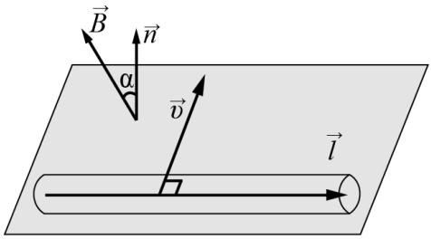 |
|  | 3.4.5 | Правило Ленца |
|  | 3.4.6 | Индуктивность: $L = \frac{\Phi}{I}$, или $\Phi = LI$. |
|  |  | Самоиндукция. ЭДС самоиндукции: $\mathcal{E}_{si} = -L \frac{\Delta I}{\Delta t} \bigg\vert_{\Delta t \to 0} = -LI'_t$ |
|  | 3.4.7 | Энергия магнитного поля катушки с током: $W_L = \frac{LI^2}{2}$ |
| 3.5 |  | ЭЛ ЕКТРОМАГНИТНЫЕ КОЛЕБАНИЯ И ВОЛНЫ |
|  | 3.5.1 | Колебательный контур. Свободные электромагнитные колебания в идеальном колебательном контуре: $\begin{cases} q(t) = q_{\max} \sin(\omega t + \varphi_0) \\ I(t) = q'_t = \omega q_{\max} \cos(\omega t + \varphi_0) = I_{\max} \cos(\omega t + \varphi_0) \end{cases}$ 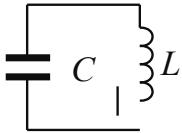Формула Томсона: $T = 2\pi \sqrt{LC}$, откуда $\omega = \frac{2\pi}{T} = \frac{1}{\sqrt{LC}}$. Связь амплитуды заряда конденсатора с амплитудой силы тока при свободных электромагнитных колебаниях в идеальном колебательном контуре: $q_{\max} = \frac{I_{\max}}{\omega}$ |
|  | 3.5.2 | Закон сохранения энергии в идеальном колебательном контуре: $\frac{CU^2}{2} + \frac{LI^2}{2} = \frac{CU^2_{\max}}{2} = \frac{LI^2_{\max}}{2} = const.$ |
|  | 3.5.3 | Вынужденные электромагнитные колебания. Резонанс |
|  | 3.5.4 | Переменный ток. Производство, передача и потребление электрической энергии |
|  | 3.5.5 | Свойства электромагнитных волн. Взаимная ориентация векторов в электромагнитной волне в вакууме: $\vec{E} \perp \vec{B} \perp \vec{c}$ |
|  | 3.5.6 | Шкала электромагнитных волн. Применение электромагнитных волн в технике и быту |
| 3.6 |  | ОПТИКА |
|  | 3.6.1 | Прямолинейное распространение света в однородной среде. Точечный источник. Луч света |
|  | 3.6.2 | Законы отражения света. $\alpha = \beta$ 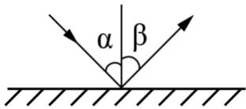 |
|  | 3.6.3 | Построение изображений в плоском зеркале |
|  | 3.6.4 | Законы преломления света. Преломление света: $n_1 \sin \alpha = n_2 \sin \beta$. Абсолютный показатель преломления: $n_{\text{абс}} = \frac{c}{\upsilon}$. Относительный показатель преломления: $n_{\text{отн}} = \frac{n_2}{n_1} = \frac{\upsilon_1}{\upsilon_2}$. |
|  |  | Ход лучей в призме. Соотношение частот и соотношение длин волн при переходе монохроматического света через границу раздела двух оптических сред: $\nu_{1} = \nu_{2}, n_{1}\lambda_{1} = n_{2}\lambda_{2}$ |
|  | 3.6.5 | Полное внутреннее отражение. Предельный угол полного внутреннего отражения: $\sin\alpha_{\text{пр}} = \frac{1}{n_{\text{отн}}} = \frac{n_{2}}{n_{1}}$ 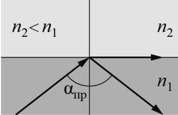 |
|  | 3.6.6 | Собирающие и рассеивающие линзы. Тонкая линза. Фокусное расстояние и оптическая сила тонкой линзы: $D = \frac{1}{F}$ |
|  | 3.6.7 | Формула тонкой линзы: $\frac{1}{d} + \frac{1}{f} = \frac{1}{F}.$ Увеличение, даваемое линзой: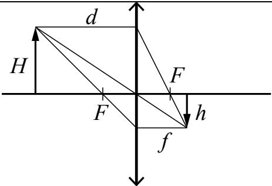 $\Gamma = \frac{h}{H} = \frac{\vert f\vert}{d}.$ В случае рассеивающей линзы: $D < 0 \Rightarrow F = \frac{1}{D} < 0, \Gamma = \frac{h}{H} = \frac{\vert f\vert}{d} < 1$ |
|  | 3.6.8 | Ход луча, прошедшего линзу под произвольным углом к её главной оптической оси. Построение изображений точки и отрезка прямой в собирающих и рассеивающих линзах и их системах |
|  | 3.6.9 | Фотоаппарат как оптический прибор. Глаз как оптическая система |
|  | 3.6.10 | Интерференция света. Когерентные источники. Условия наблюдения максимумов и минимумов в интерференционной картине от двух синфазных когерентных источников: максимумы – $\Delta = 2m\frac{\lambda}{2}, m = 0, \pm 1, \pm 2, \pm 3, \dots$, минимумы – $\Delta = (2m + 1)\frac{\lambda}{2}, m = 0, \pm 1, \pm 2, \pm 3, \dots$ |
|  | 3.6.11 | Дифракция света. Дифракционная решётка. Условие наблюдения главных максимумов при нормальном падении монохроматического света с длиной волны $\lambda$ на решётку с периодом d: $d \sin\varphi_{m} = m\lambda, m = 0, \pm 1, \pm 2, \pm 3, \dots$ |
|  | 3.6.12 | Дисперсия света |
| 4 |  | КВАНТОВАЯ ФИЗИКА |
| 4.1 |  | КОРПУСКУЛЯРНО-ВОЛНОВОЙ ДУАЛИЗМ |
|  | 4.1.1 | Гипотеза М. Планка о квантах. Формула Планка: $E = h\nu$ |
|  | 4.1.2 | Фотоны. Энергия фотона: $E = h\nu = \frac{hc}{\lambda} = pc$. Импульс фотона: $p = \frac{E}{c} = \frac{h\nu}{c} = \frac{h}{\lambda}$ |
|  | 4.1.3 | Фотоэффект. Опыты А.Г. Столетова. Законы фотоэффекта |
|  | 4.1.4 | Уравнение Эйнштейна для фотоэффекта: $E_{\text{фотона}} = A_{\text{выхода}} + E_{\text{кин max}}$, где $E_{\text{фотона}} = h\nu = \frac{hc}{\lambda}$, $A_{\text{выхода}} = h\nu_{\text{кр}} = \frac{hc}{\lambda_{\text{кр}}}$, $E_{\text{кин max}} = \frac{m\upsilon_{\text{max}}^2}{2} = eU_{\text{зап}}$ |
|  | 4.1.5 | Давление света. Давление света на полностью отражающую поверхность и на полностью поглощающую поверхность |
| 4.2 |  | ФИЗИКА АТОМА |
|  | 4.2.1 | Планетарная модель атома |
|  | 4.2.2 | Постулаты Бора. Излучение и поглощение фотонов при переходе атома с одного уровня энергии на другой: $h\nu_{mn} = \frac{hc}{\lambda_{mn}} = \vert E_n - E_m\vert $ |
|  | 4.2.3 | Линейчатые спектры. Спектр уровней энергии атома водорода: $E_n = \frac{-13,6 \text{ эВ}}{n^2}$, $n=1,2,3,...$ |
| 4.3 |  | ФИЗИКА АТОМНОГО ЯДРА |
|  | 4.3.1 | Нуклонная модель ядра Гейзенберга – Иваненко. Заряд ядра. Массовое число ядра. Изотопы |
|  | 4.3.2 | Радиоактивность. Альфа-распад: ${}^{A}_{Z}\mathrm{X} \to {}^{A-4}_{Z-2}\mathrm{Y} + {}^{4}_{2}\mathrm{He}$. Бета-распад. Электронный β-распад: ${}^{A}_{Z}\mathrm{X} \to {}^{A}_{Z+1}\mathrm{Y} + {}^{0}_{-1}e + \tilde{\nu}_e$. Позитронный β-распад: ${}^{A}_{Z}\mathrm{X} \to {}^{A}_{Z-1}\mathrm{Y} + {}^{0}_{+1}\tilde{e} + \nu_e$. Гамма-излучение |
|  | 4.3.3 | Закон радиоактивного распада: $N(t) = N_0 \cdot 2^{-\frac{t}{T}}$. Пусть m – масса радиоактивного вещества. Тогда $m(t) = m_0 \cdot 2^{-\frac{t}{T}}$ |
|  | 4.3.4 | Ядерные реакции. Деление и синтез ядер |

»;
